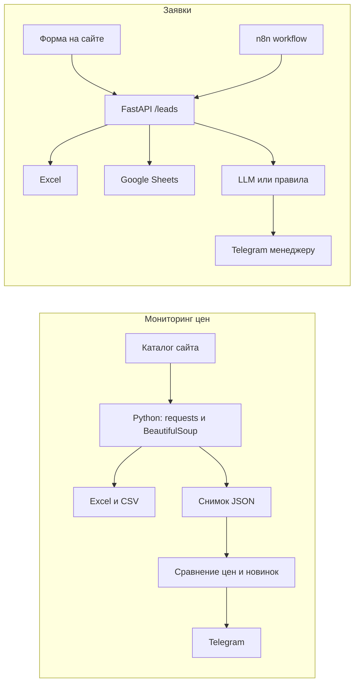

# Автоматизация заявок и рутины

Два рабочих примера на Python 3.11+: мониторинг цен каталога и приём заявок с сайта. Их можно запустить локально, прогнать тестами и переложить на свой сайт, таблицу или CRM.

Каталог в примере — песочница [books.toscrape.com](https://books.toscrape.com) («We love being scraped!»). Боевые токены в репозиторий не входят: без них сводки печатаются в консоль.

## Какие задачи закрывают примеры

**Мониторинг цен** (`price-monitor/`) снимает каталог по расписанию и оставляет менеджеру файл, а не ручную сверку.

- обходит страницы каталога и забирает название, цену, наличие и рейтинг;
- сохраняет полный срез в Excel и CSV;
- помнит прошлый снимок и присылает в Telegram только новые товары и изменившиеся цены.

**Заявки с сайта** (`leads-webhook/`) забирает форму и доводит её до менеджера.

- проверяет имя, телефон или email и текст;
- дописывает строку в Excel и, если задан сервисный аккаунт, в Google Sheets;
- ставит категорию и приоритет: через OpenAI-совместимую модель (OpenRouter, Groq, Ollama) либо правилами по словам, если модель недоступна;
- отправляет менеджеру сообщение в Telegram;
- рядом лежит черновик сценария n8n для той же цепочки.

## Схема



## Быстрый старт

```bash
python3 -m venv .venv
source .venv/bin/activate
pip install -r requirements.txt
cp .env.example .env
```

Проверка без сети и без токенов:

```bash
ruff check .
pytest
```

Мониторинг одной страницы каталога. Файлы появятся в `price-monitor/data/`. Первый запуск только сохраняет снимок.

```bash
cd price-monitor
python -m price_monitor.main --max-pages 1 --delay 0
```

Вебхук заявок:

```bash
cd leads-webhook
uvicorn leads_webhook.main:app --reload --port 8000
```

```bash
curl -s http://127.0.0.1:8000/leads \
  -H 'Content-Type: application/json' \
  -d '{"name":"Анна","phone":"+7 999 123-45-67","message":"Сколько стоит связать заявки с Google Таблицей?","source":"site"}'
```

Ответ:

```json
{
  "id": "ab12cd34ef56",
  "name": "Анна",
  "category": "pricing",
  "priority": "normal",
  "summary": "Сколько стоит связать заявки с Google Таблицей?",
  "classifier": "rules",
  "stored": ["excel"],
  "notified": "console"
}
```

Образ вебхука собирается из корня репозитория:

```bash
docker build -f leads-webhook/Dockerfile -t leads-webhook .
docker run --rm -p 8000:8000 --env-file .env \
  -v "$PWD/leads-webhook/data:/app/leads-webhook/data" \
  leads-webhook
```

Подробности, переменные и cron — в [price-monitor/README.md](price-monitor/README.md) и [leads-webhook/README.md](leads-webhook/README.md).

## Примеры вывода

Фрагмент `price-monitor/data/catalogue.xlsx` (шапка закреплена, у колонок задана ширина, цена — число):

| Название | Цена | Валюта | Наличие | В наличии | Рейтинг | Ссылка |
| --- | ---: | --- | --- | --- | ---: | --- |
| A Light in the Attic | 51.77 | GBP | In stock | да | 3 | https://books.toscrape.com/catalogue/a-light-in-the-attic_1000/index.html |
| Tipping the Velvet | 53.74 | GBP | In stock | да | 1 | https://books.toscrape.com/catalogue/tipping-the-velvet_999/index.html |

Тот же срез пишется в `catalogue.csv` (UTF-8 с BOM, чтобы Excel на Windows открыл кириллицу в шапке).

Сообщение в Telegram, когда у книги изменилась цена и появилась новая позиция. Без `TELEGRAM_BOT_TOKEN` и `TELEGRAM_CHAT_ID` тот же текст печатается в консоль:

```text
Мониторинг цен — books.toscrape.com
Источник: https://books.toscrape.com/catalogue/page-1.html
Проверено позиций: 2
Новых товаров: 1
Изменения цен: 1

Новые товары:
• A Light in the Attic — 51.77 GBP, в наличии, рейтинг 3/5
  https://books.toscrape.com/catalogue/a-light-in-the-attic_1000/index.html

Изменения цен:
• Tipping the Velvet — 53.74 → 49.00 GBP (-8.8%)
  https://books.toscrape.com/catalogue/tipping-the-velvet_999/index.html
```

Заявка в `leads-webhook/data/leads.xlsx`, лист «Заявки»:

| ID | Дата UTC | Имя | Телефон | Email | Сообщение | Источник | Категория | Приоритет | Кратко | Классификатор |
| --- | --- | --- | --- | --- | --- | --- | --- | --- | --- | --- |
| ab12cd34ef56 | 2026-11-03 09:00:00 | Анна | +7 999 123-45-67 |  | Сколько стоит связать заявки с Google Таблицей? | site | pricing | normal | Сколько стоит связать заявки с Google Таблицей? | rules |

Сообщение менеджеру:

```text
Новая заявка ab12cd34ef56
Имя: Анна
Телефон: +7 999 123-45-67
Email: —
Источник: site
Категория: pricing
Приоритет: normal
Классификатор: rules

Сколько стоит связать заявки с Google Таблицей?
```

## Что лежит в репозитории

```text
.env.example                  общие переменные
requirements.txt              зависимости, тесты и ruff
.github/workflows/ci.yml      ruff и pytest на Python 3.11 и 3.12
price-monitor/                парсер, снимок, Excel/CSV, Telegram, cron.example
leads-webhook/                FastAPI, Dockerfile, классификация
n8n/leads-workflow.json       сценарий n8n: форма → вебхук
```

CI на GitHub Actions гоняет `ruff check` и `pytest` для Python 3.11 и 3.12. Парсер проверяется на сохранённом HTML, без запросов в интернет.

## Заказать автоматизацию

Нужно так же забирать заявки в CRM, связать сайт с Telegram и Google Sheets или собрать сценарий в n8n под ваш процесс — напишите на Kwork: <https://kwork.ru/user/karagodini>.

## Лицензия

[MIT](LICENSE).
